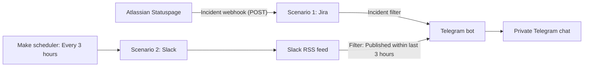

# automation-portfolio

# Multi-Service Status Monitor with Telegram Alerts

A lightweight monitoring system that tracks service disruptions affecting **Jira** and **Slack**, sending Telegram notifications whenever an incident is reported.

Built using **Make (free plan)**, a Telegram bot, and official service status feeds.

> **Status:** Operational | **Cost:** $0/month | **Tools:** Make, Telegram Bot API, Atlassian Statuspage, RSS

<!-- TODO: Add a screenshot of a real alert with sensitive information removed. -->

## The Problem

When a workplace tool stops working, the first instinct is usually to troubleshoot locally: checking the internet connection, restarting the application, or assuming something is wrong with the device. Only afterward do we check the provider's status page.

With multiple services, this means manually checking different websites whenever something seems wrong.

The goal was simple: **Instead of searching for incidents, let the alerts come to you.**

## The Solution

Two automated scenarios in Make monitor official service status sources and send Telegram notifications when new incidents are detected.

| Service | Official source | Method | Approximate latency |
| --- | --- | --- | --- |
| Jira | Atlassian Statuspage | Webhook (push) | Near real-time |
| Slack | Official status RSS feed | Scheduled polling | Up to 3 hours |

Both scenarios send notifications to the same Telegram bot, providing a centralized channel for service disruption alerts.

## Architecture

### Scenario 1: Jira (Event-Driven)

Jira monitoring uses Atlassian's webhook functionality to receive incident notifications as they happen.

1. Atlassian sends an HTTP `POST` request to a Make webhook whenever an incident is created or updated.
2. A filter removes component status notifications that do not contain an `incident` object.
3. Make extracts the relevant information from the webhook payload.
4. The Telegram bot sends the incident name, impact level, current status, latest update, and incident URL.

Because this scenario is event-driven, it does not require scheduled requests to check whether Jira is experiencing problems.

### Scenario 2: Slack (Scheduled Polling)

Slack monitoring uses the official RSS feed from its status page.

1. A Make scheduler triggers the scenario every 3 hours.
2. The RSS module retrieves recent entries from Slack's status feed.
3. A date filter allows only entries published within the last 3 hours.
4. Matching entries are forwarded to the Telegram bot.

This approach provides automated monitoring without requiring a continuously running server.

## Technical Decisions

### Webhooks vs. Polling

**Jira — Webhook (push):** Atlassian supports webhook subscriptions for status incidents. Make receives notifications when events occur, avoiding scheduled requests and providing near real-time alerts.

**Slack — RSS polling:** I used Slack's official status RSS feed because a suitable webhook subscription was not available through the integration approach I evaluated. Make checks the feed periodically, even when there are no incidents. The trade-off is higher operation consumption and delayed notifications.

### Working Within Make's Free Plan

At the time this project was built, Make's free plan included 1,000 operations per month and 2 active scenarios. These limits influenced the architecture and polling frequency.

Checking an RSS feed every 15 minutes would require approximately 2,880 checks per 30-day month, exceeding the free operation allowance even before accounting for other modules.

| Polling interval | Approximate monthly RSS checks |
| --- | ---: |
| Every 15 minutes | 2,880 |
| Every hour | 720 |
| Every 3 hours | 240 |

*Actual Make operation consumption may be higher depending on module executions and how many feed entries are processed.*

I chose a 3-hour interval to keep operation consumption low while maintaining automated monitoring. This means a Slack incident may be detected up to 3 hours after being published.

> Make's pricing and free plan limitations may change. These figures reflect the configuration used when the project was developed.

### Date-Based Filtering Instead of Persistent Storage

To reduce complexity and avoid additional Make operations, the Slack scenario uses a date-based filter rather than storing previously processed incident IDs. Only entries published within the previous 3 hours are allowed through.

This approach requires no external database, keeps operation consumption low, and is straightforward to implement. However, an entry published near the boundary between two polling windows could be missed or processed more than once. A future version will track incident identifiers instead.

## Testing and Validation

Because service outages are unpredictable, I tested the workflows using simulated events and manual executions.

| Component | Testing method | Result |
| --- | --- | --- |
| Telegram bot | Test message sent through Make | Successful |
| Jira scenario | Simulated HTTP `POST` using Atlassian's webhook payload structure | Successful; complete notification received |
| Slack scenario | Full execution with RSS feed and date filter | Successful; no matching recent incidents |

### Jira Webhook Validation

To test the Jira workflow without waiting for an actual outage, I sent a simulated HTTP request to the Make webhook, following Atlassian's documented incident payload structure.

This validated webhook reception, incident filtering, data extraction, Telegram message formatting, and end-to-end delivery. The test notification arrived with the expected information.

The Jira Webhook validation was tested on PowerShell as shown below:

$body = @'
{"meta":{"unsubscribe":"http://example.com","documentation":"http://example.com"},"page":{"id":"x","status_indicator":"minor","status_description":"Test"},"incident":{"id":"test1","name":"TEST: example incident","status":"investigating","impact":"minor","shortlink":"https://status.atlassian.com","incident_updates":[{"body":"This is a test of my status alert.","status":"investigating","created_at":"2026-10-18T12:00:00Z"}]}}
'@
Invoke-RestMethod -Method Post -Uri [Webhook URL] -Body $body -ContentType "application/json"

**Remaining validation:** The webhook has not yet received a real Jira incident.

### Slack RSS Validation

The Slack scenario was executed manually. The RSS module, date filter, and scenario ran without errors. No incidents had been published within the configured time window, so the filter correctly returned zero matching entries.

**Remaining validation:** Delivery of a real Slack incident notification has not yet been verified.

## Known Limitations

- **Notification latency:** Slack incidents may take up to 3 hours to trigger an alert. Short incidents might already be resolved when the notification arrives.
- **Repeated notifications:** A single incident may generate multiple RSS entries as its status changes (investigating, identified, monitoring, resolved).
- **Polling boundary issues:** Date-based filtering may miss or repeat entries near the boundary between cycles.
- **Dependency on Make:** Changes to modules, scenario behavior, or free plan limits could require adjustments.

### Simulate Events When Real-World Testing Is Difficult

Waiting for a real Jira outage would have made testing unpredictable. Sending a simulated HTTP `POST` let me validate the complete workflow without waiting for an incident.

### Estimate Resource Consumption Before Deployment

A 15-minute polling interval seemed reasonable at first, but it would exceed Make's free monthly operation allowance. Calculating expected usage helped me select a sustainable configuration.

